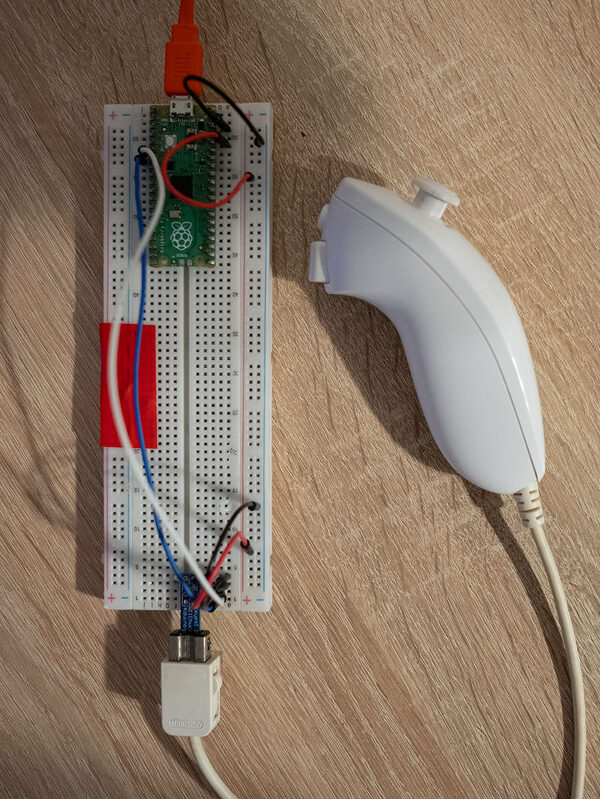
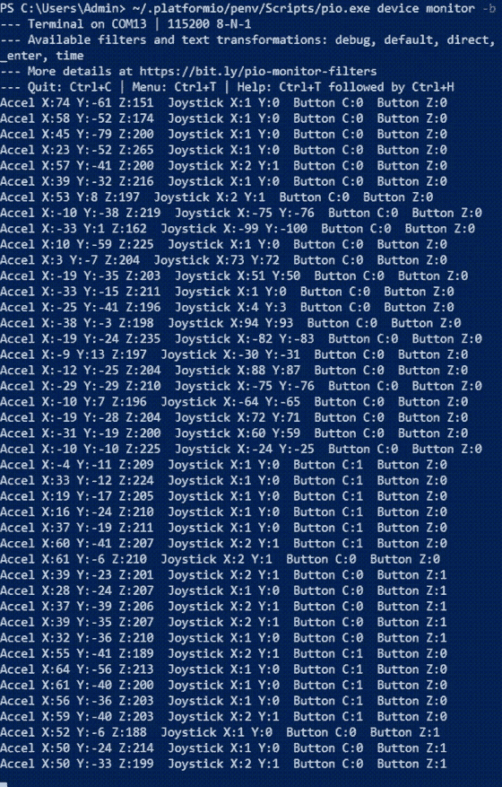

# PicoNunchuck

> PL: Odczyt kontrolera Wii Nunchuck przez I2C na Raspberry Pi Pico, napisany w C++ na Pico SDK. Program wypisuje przez USB wychylenie drążka, akcelerometr i stan przycisków C i Z. Zrobiłem to, żeby nauczyć się Pico SDK i I2C.

A small C++ program for the Raspberry Pi Pico that reads a Wii Nunchuck over I2C and prints the stick position, the accelerometer values and the state of the C and Z buttons over USB serial. It uses the Pico SDK directly, with no Nunchuck library.

I was curious how the Wii Remote talks to the devices plugged into its port. It turned out to be plain I2C. I had a Nunchuck at hand, and I wanted to learn the Pico SDK and how to do I2C with it, so I decided to try.

The code is heavily inspired by [Infusion's Nunchuk Fritzing project](https://github.com/infusion/Fritzing/tree/master/Nunchuk).



## Output



The program keeps printing lines with:

- the accelerometer X, Y and Z values. They're 10-bit readings with 512 subtracted.
- the stick X and Y position, with the centre (127 and 128) subtracted.
- buttons C and Z, where 1 means pressed.

The zero points are constants at the top of `nunchuck.hpp`. They aren't calibrated for a particular controller.

The Nunchuck has to be plugged in before the Pico starts, because the program sets it up only once, a second after power-up. If the Nunchuck doesn't answer, the program keeps printing `Cannot initialize device - check the wiring!`.

## Wiring

I used a cheap Nunchuck breakout from AliExpress, so I didn't have to cut the cable.

| Nunchuck | Pico |
|---|---|
| 3.3 V | 3V3(OUT) |
| GND | GND |
| SDA | GP4 |
| SCL | GP5 |

The program uses `i2c0` at 100 kHz, and the Nunchuck is at address `0x52`. It turns on the Pico's internal pull-ups on both lines, and I didn't add external ones.

The Nunchuck runs on 3.3 V only. Don't connect its power pin to 5 V (VBUS or VSYS), because that will damage the Nunchuck.

## Building and flashing

The easiest way is the Raspberry Pi Pico extension for VS Code. The project is set up for it (Pico SDK 2.0.0, ARM toolchain 13.2.Rel1), and it downloads everything it needs by itself.

To build from the command line you need:

- the [Pico SDK](https://github.com/raspberrypi/pico-sdk) 2.0.0 with its submodules (`git submodule update --init`), because USB serial needs TinyUSB from `lib/tinyusb`. Set `PICO_SDK_PATH` to it.
- the [ARM GNU toolchain](https://developer.arm.com/downloads/-/arm-gnu-toolchain-downloads) (`arm-none-eabi-gcc`) on your `PATH`.
- CMake and a build tool such as Ninja or Make.
- Python 3, which the SDK uses during the build.
- [picotool](https://github.com/raspberrypi/pico-sdk-tools/releases) 2.0.0, which SDK 2.0 uses to make the `.uf2` file. If CMake can't find it, it tries to download and build picotool from source, which needs a native C++ compiler. With a prebuilt one, point CMake at it with `-Dpicotool_DIR=<folder with picotoolConfig.cmake>`.

`pico_sdk_import.cmake` isn't in the repo, so copy it from the SDK first:

```
cp $PICO_SDK_PATH/external/pico_sdk_import.cmake .
cmake -S . -B build -G Ninja
cmake --build build
```

On Windows, use `-G Ninja` (or `-G "MinGW Makefiles"`), because otherwise CMake picks a Visual Studio generator, which can't use the ARM toolchain.

To flash, hold the BOOTSEL button on the Pico while plugging in USB. A drive called `RPI-RP2` appears. Copy `build/pico-nunchuck.uf2` to that drive.

The output goes over USB, so after flashing the Pico shows up as a serial port. Open it in any serial terminal.

## Related

I kept experimenting with the Nunchuck after this. [NunchuckMouse](https://github.com/Ketnak22/NunchuckMouse) turns it into a USB mouse, with Arduino firmware and a small PCB that I designed for it.